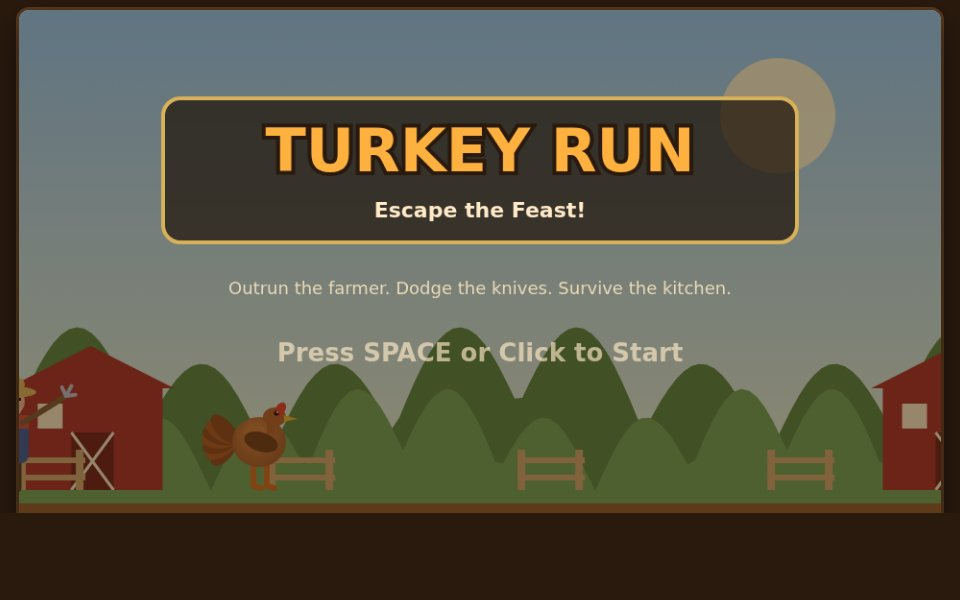
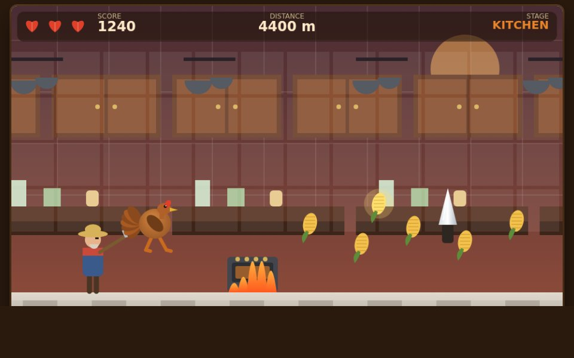
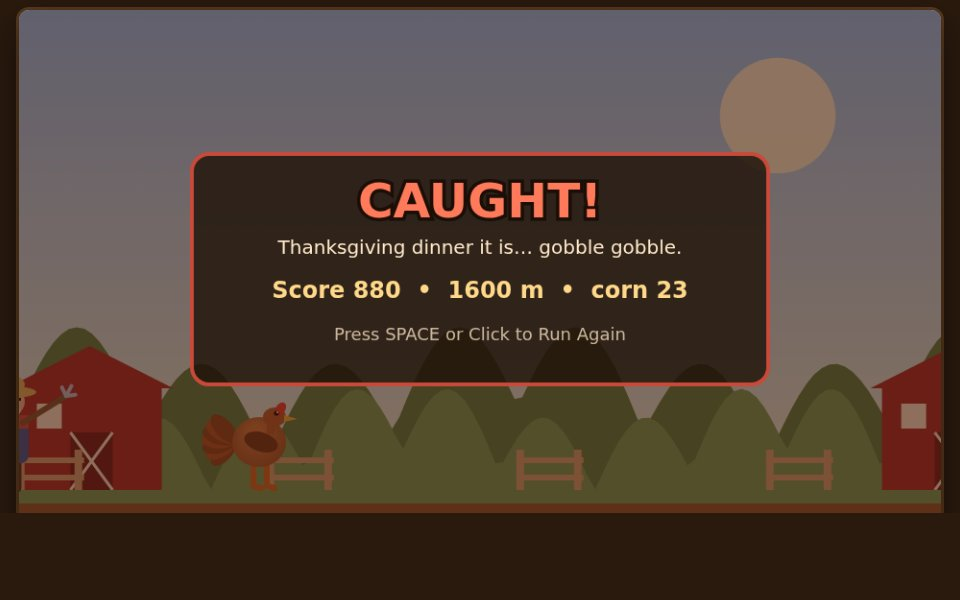

# Turkey Run: Escape the Feast 🦃

A fast, hand-crafted Thanksgiving escape game for the make.fun bounty
[turkey-run-game-01](https://make.fun/c/turkey-run-game-01). You are the
turkey, minutes from becoming dinner: outrun the pitchfork-waving farmer
across three escalating stages — the open **Farmyard**, the **Orchard**, and
the heart-stopping **Kitchen** — dodging carving knives, roaming jack-o'-lantern
pumpkins and oven flame bursts, hoovering up corn for score.

[](https://make.fun/c/turkey-run-game-01)
[](https://make.fun/c/turkey-run-game-01)
[](https://make.fun/c/turkey-run-game-01)





## Play

```sh
node serve.ts        # serves game/ on http://localhost:8080
```

Open http://localhost:8080 in desktop Chrome. No build step, no network: every
script, style and sound is a plain file under `game/` (sounds are synthesised
with the Web Audio API — zero audio assets).

## Controls

| Key | Action |
| --- | --- |
| ← / → | run (the turkey always sprints; speed grows with distance) |
| ↑ | jump — press again mid-air for a wing-flap double jump |
| ↓ | slide under low carving knives |
| P | pause |

## What's in the game

- **Chase pressure**: the farmer closes in as difficulty rises; a hit costs a
  feather-heart and lets him lunge closer. Red vignette and his "YOOOU!"
  bubble warn you he's near. Three hearts, then it's *CAUGHT!* — Thanksgiving
  dinner.
- **Win condition**: reach 6,000 m and you're *ESCAPED!* — nobody's dinner this year.
- **Hazards**: carving knives slide low (duck!) or arc high (jump!), ovens fire
  periodic flame bursts, pumpkins roam. All scale up over the run.
- **Pickups**: corn (+10), golden corn (+50, speed boost, restores a heart).
- **Stages**: Farmyard → Orchard → Kitchen, each with its own palette, props,
  and hazards.
- **Feel**: run/jump/flap/slide animation cycles, feather-burst and dust
  particles, hurt blinking, stride footsteps, procedural jump/pickup/hit/
  caught/escaped sounds, parallax everything.

## Source layout (one job per file)

```
game/index.html        page shell, canvas, key legend
game/css/style.css     page chrome and stage sizing
game/js/main.js        boot + screenshot-harness hook (?shot=start|play|end)
game/js/engine.js      game loop, state machine, input, collisions
game/js/world.js       parallax backdrops and stage theming
game/js/player.js      the turkey: animation, physics, particles
game/js/farmer.js      the chasing farmer and his pitchfork
game/js/hazards.js     knives, ovens, roaming pumpkins
game/js/pickups.js     corn and golden corn
game/js/particles.js   shared particle pool
game/js/hud.js         score / distance / lives / stage HUD
game/js/screens.js     title and end screens
game/js/audio.js       procedural Web Audio sound kit
```

## Hand-in

`node main.ts` (or `MAKEFUN_OUTPUT_DIR=out node main.ts`) copies `game/` and
`screenshots/` and writes `dossier.json` via the kit's `vendor/makefun-game.ts`.
The three screenshots are real renders of this game's own code, captured from
headless Chrome running `game/` itself.

## License

MIT — see [LICENSE](LICENSE).
